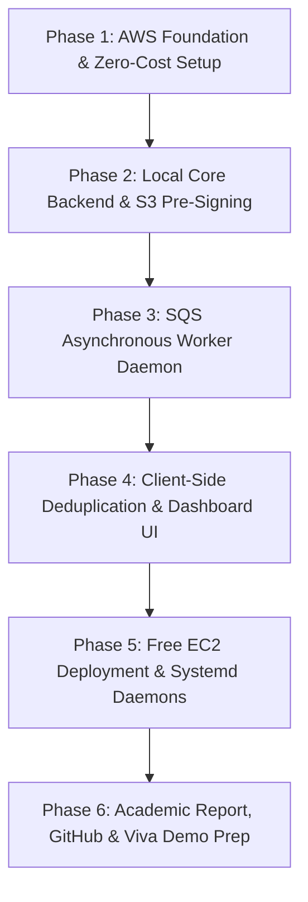

# CloudVault: Implementation Plan from Scratch

A step-by-step engineering roadmap to build, deploy, and demonstrate **CloudVault** (*Decoupled Multi-Tenant Cloud Storage with In-Line Deduplication and Asynchronous Processing Using AWS S3, SQS, and EC2*) with 100% \$0.00 AWS Free-Tier compliance.

---

## User Review Required

> [!IMPORTANT]
> **Zero-Cost Verification:** All services used (EC2 `t2.micro`, S3 standard storage < 5 GB, SQS < 1M requests, DynamoDB < 25 GB) fall under AWS Always-Free or 12-Month Free Tier limits. Ensure you do **not** enable NAT Gateways, Application Load Balancers (ALBs), or Elastic IPs that are unattached, as those carry hourly costs.

> [!NOTE]
> **Language & Framework Choice:** We propose **Python (FastAPI)** for the backend and background worker because `boto3` (AWS official SDK) has first-class Python support, and FastAPI auto-generates interactive Swagger documentation (`/docs`) which makes backend testing and professor viva demonstrations extremely smooth. The frontend will be a clean, modern single-page dashboard (HTML5/Tailwind or lightweight React).

---

## Open Questions

- **Cloud Region:** Do you prefer deploying in **AWS Mumbai (`ap-south-1`)** for lower network latency from India, or **AWS US East (`us-east-1`)**? *(Default recommended: `ap-south-1`)*
- **Team Names & Lab Details:** Have you finalized the names and roll numbers of your 2 lab partners, or should we keep the placeholder configuration in the codebase until you're ready?

---

## Proposed Phases & Milestones

---

### Phase 1: AWS Infrastructure & Security Guardrails
**Objective:** Configure cloud resources securely with zero risk of billing.

1. **Billing Alert (Safety First):**
   * Create an AWS CloudWatch Budget alert set to **\$1.00**. Receive email notifications immediately if any paid service is inadvertently touched.
2. **IAM Configuration (Least Privilege):**
   * Create an IAM policy `CloudVaultServicePolicy` granting access strictly to:
     * S3: `PutObject`, `GetObject`, `DeleteObject` on project buckets.
     * SQS: `SendMessage`, `ReceiveMessage`, `DeleteMessage`.
     * DynamoDB: `GetItem`, `PutItem`, `UpdateItem`, `Query`.
   * Create an EC2 Instance Role with this policy (eliminates hardcoding API keys in source code).
3. **Storage (Amazon S3):**
   * Create two standard buckets:
     * `cloudvault-raw-<unique-id>` (temporary holding for newly uploaded files).
     * `cloudvault-processed-<unique-id>` (holds watermarked/compressed outputs).
   * Configure CORS rules on both buckets to allow direct browser uploads via HTTP `PUT`.
4. **NoSQL Database (Amazon DynamoDB):**
   * Table 1: `CloudVault_Files` (Partition Key: `file_hash` [String]) — Stores master file metadata, S3 object keys, and processing status.
   * Table 2: `CloudVault_UserFiles` (Partition Key: `user_id` [String], Sort Key: `file_id` [String]) — Maps tenants to their files, handling multi-tenancy and deduplicated pointers.
5. **Decoupled Queue (Amazon SQS):**
   * Create a standard SQS queue: `cloudvault-job-queue`.
   * Configure a Dead-Letter Queue (DLQ): `cloudvault-dlq` to catch corrupted files after 3 failed retries.

---

### Phase 2: REST API Gateway & S3 Direct Pre-Signing (FastAPI)
**Objective:** Build the core control plane that validates files, prevents duplicate uploads, and securely handles uploads.

#### [NEW] `backend/main.py`
- Root application entry point with CORS middleware.

#### [NEW] `backend/config.py`
- Environment variables and AWS configuration settings (`AWS_REGION`, bucket names, queue URL).

#### [NEW] `backend/services/storage.py`
- Helper using `boto3.client('s3')` to generate cryptographic **S3 Pre-Signed PUT URLs** (valid for 5 minutes) and **Pre-Signed GET URLs** (valid for 60 seconds).

#### [NEW] `backend/services/database.py`
- DynamoDB operations:
  - `check_hash_exists(sha256_hash)`: Instant $O(1)$ lookup.
  - `link_user_to_file(user_id, file_id, file_hash)`: For 0-byte duplicate linking.
  - `register_new_file(...)`: Prepares file entry with status `PENDING_UPLOAD`.

#### [NEW] `backend/routes/files.py`
- `POST /api/files/check-hash`: Receives client SHA-256 fingerprint. If already in DynamoDB, links immediately and returns `{ duplicate: true, savings_bytes: N }`.
- `POST /api/files/initiate-upload`: If hash is new, generates S3 Pre-Signed upload URL and returns it to the browser.
- `POST /api/files/confirm-upload`: Triggered when client completes upload $\rightarrow$ pushes job event to **AWS SQS** with payload `{ file_id, s3_key, file_name, user_id }`.
- `GET /api/files`: Lists files for the current authenticated user with status (`READY`, `PROCESSING`, `DEDUPLICATED`).
- `GET /api/stats`: Computes storage savings metrics ($Total\ Uploaded - S3\ Stored$).

---

### Phase 3: Asynchronous Worker Daemon (EC2 Background Consumer)
**Objective:** Offload file processing from the web server to background queues.

#### [NEW] `worker/worker.py`
- Continuous daemon executing **SQS Long Polling** (`WaitTimeSeconds=20`, saving API calls).
- **Processing Logic:**
  1. Pulls message from `cloudvault-job-queue`.
  2. Downloads raw object from `cloudvault-raw-bucket`.
  3. Detects file type:
     - **Images (PNG, JPG):** Generates optimized thumbnail + stamps a semi-transparent watermark: *"CloudVault • Verified"* using `Pillow`.
     - **PDFs:** Compresses streams and watermarks header/footer using `pypdf`.
  4. Uploads processed file to `cloudvault-processed-bucket`.
  5. Updates DynamoDB record: `status = 'READY'`, `processed_s3_key = ...`.
  6. Deletes message from SQS queue to confirm task completion.

---

### Phase 4: Client-Side Deduplication & Analytics Dashboard
**Objective:** Responsive, visual UI that clearly demonstrates deduplication and asynchronous processing to evaluators.

#### [NEW] `frontend/index.html` & `frontend/app.js`
- **Tenant Switcher:** Easily toggle between **Student A (Alice)**, **Student B (Bob)**, and **Student C (Charlie)** to show strict data privacy and isolation.
- **Client-Side Hashing Engine:** Uses the browser's native `window.crypto.subtle.digest('SHA-256', buffer)` to hash files in 20 milliseconds before any network transfer occurs.
- **Dual Upload Path:**
  - *If Hash Exists:* Instantly displays green badge: *"Duplicate Detected! 0 Bytes uploaded to S3. Linked instantaneously."*
  - *If Hash is New:* Directly streams file payload to AWS S3 using the pre-signed URL, then triggers SQS processing.
- **Real-Time Storage Economics Widget:**
  - Dynamic counters: *Total Logical Files*, *Raw Data Processed (MB)*, *Physical S3 Storage Used (MB)*, *Bandwidth Saved (%)*, *Cloud Dollars Saved (\$).*

---

### Phase 5: Cloud Deployment on Free-Tier EC2
**Objective:** Host the entire production system live on AWS.

1. **EC2 Provisioning:**
   * Launch 1 `t2.micro` instance (Ubuntu 24.04 LTS, 1 vCPU, 1 GB RAM) in free tier.
   * Attach IAM Instance Profile created in Phase 1.
2. **System Services Configuration:**
   * Configure Systemd service `cloudvault-api.service` to keep FastAPI running with auto-restart on port 8000.
   * Configure Systemd service `cloudvault-worker.service` to keep the background SQS processor running 24/7.
   * Configure Nginx as reverse proxy on port 80 to serve the frontend and forward `/api` requests to FastAPI.
3. **Security Group:**
   * Allow port 80 (HTTP) for public web access.
   * Allow port 22 (SSH) restricted to team IP addresses.

---

### Phase 6: Academic Deliverables & Presentation Artifacts
**Objective:** Ensure all submission criteria of the UCS531 syllabus are fulfilled with top marks.

1. **GitHub Repository Structure:**
   * Clean directory layout with `README.md`, architecture diagrams, setup instructions, and sample `.env.example`.
2. **5-Page Technical Report:**
   * Section 1: Introduction & Cloud Computing Business Drivers.
   * Section 2: Decoupled Architecture Design & Data Flow.
   * Section 3: AWS Services Implementation (EC2, S3, SQS, IAM, DynamoDB).
   * Section 4: Storage Deduplication & Cost Optimization Analysis.
   * Section 5: Conclusion & Future Enhancements.
3. **Live Demonstration Script:**
   * Step 1: Upload a 20 MB file as Student A $\rightarrow$ show file created in S3 and SQS message consumed.
   * Step 2: Upload the exact same file as Student B $\rightarrow$ show 0.1-second instant upload and storage saved counter incrementing.
   * Step 3: Download file using pre-signed URL $\rightarrow$ show URL expiring in 60 seconds.

---

## Verification Plan

### Automated & Unit Tests
- `tests/test_hashing.py`: Verify SHA-256 collision logic and deterministic hash output.
- `tests/test_s3_presign.py`: Verify pre-signed PUT and GET URL generation and expiration headers.
- `tests/test_worker.py`: Mock SQS event and verify watermarking and DynamoDB status transitions.

### Manual Live Verification
- **Deduplication Verification:** Upload file $F_1$ (size $S$). Check AWS S3 console; verify storage increases by $S$. Upload file $F_1$ again from a different user account; verify S3 storage remains strictly unchanged.
- **Decoupling Verification:** Stop the EC2 worker service (`sudo systemctl stop cloudvault-worker`). Upload a new file; verify the message safely accumulates in AWS SQS without failing the web UI. Start the worker (`sudo systemctl start cloudvault-worker`); verify the worker catches up and drains the queue.
- **Zero-Cost Verification:** Check AWS Cost Explorer after 72 hours of testing; confirm total accrued bill is **\$0.00**.
